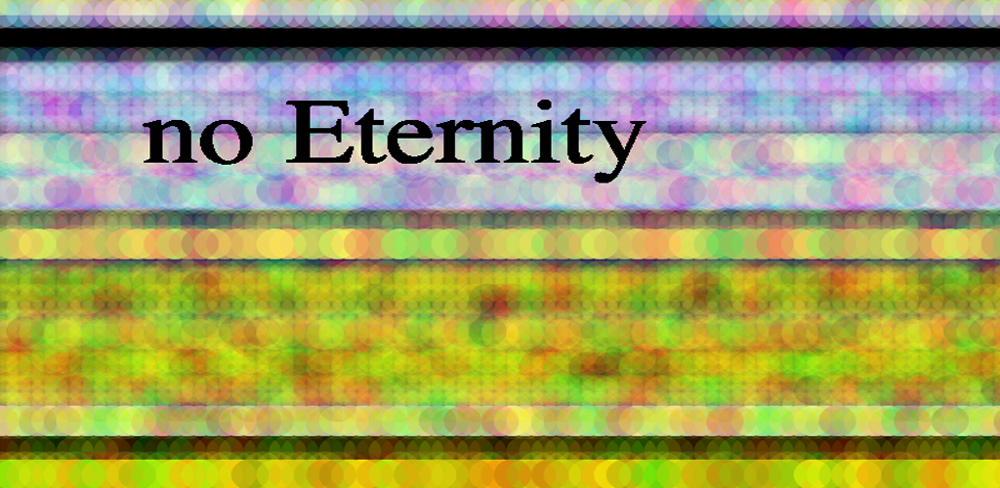

# no Eternity

A generative, iterative and interactive screen-saver artwork. By your touch, it changes.

I combine analogue feeling and digital technologies in the creation of my work.
I created composite collages that reflect on relationships between the eternity and its image.
There are no eternity.



## The web version

The piece runs in the browser on phones, tablets and computers:

- **Move the mouse or drag a finger** to paint bands of translucent colour. Every finger paints its own band, and the band keeps building where you let go, as it did in the app.
- **Hold the ◐ button, or the space bar,** to dissolve the image. This brings back the blur-and-scratch effect from the original installation, which was triggered by sensors.
- **Leave it alone** and it keeps painting itself, like a screen saver. Full screen also keeps the display awake.
- **Save** downloads the current moment as a PNG (on phones it opens the share sheet).
- Keys: arrow keys move the brush · Space dissolve · S save · F full screen · I about.

It is a static site with no server and no tracking. The code and styles together are under 10 KB gzipped, and it can be added to a home screen like an app.

### Run it locally

You need Node.js 22.12 or newer.

```bash
npm install
npm run dev        # http://localhost:5173
```

```bash
npm test           # unit tests
npm run typecheck
npm run build      # production build in dist/
npm run preview    # serve the build
npm run check      # all of the above, as CI runs it
```

### Deploy to Vercel

1. Push this repository to GitHub.
2. On [vercel.com/new](https://vercel.com/new), import the repository. Vercel detects Vite from `vercel.json`, so keep the defaults (build `npm run build`, output `dist`). No environment variables are needed.
3. Deploy. Every pull request then gets its own preview URL.

To deploy from the command line instead, run `npx vercel` (preview) or `npx vercel --prod` (production).

Link previews (for example in messages and social posts) use the production domain automatically. To use a different domain for them, set `SITE_URL` (for example `https://noeternity.art`) in the Vercel project settings.

`vercel.json` also sets long-term caching for the hashed build files and a strict Content Security Policy. If you later add a third-party script, font or analytics, add its domain to that policy.

### Change the artwork

Every tunable value is in [`src/sketch/config.ts`](src/sketch/config.ts): circle size and spacing, opacity, colour ranges, title, screen-saver speed and the dissolve effect. Each value is annotated with the line of the original sketch it comes from.

| Original (`noEternity/*.pde`)                               | Web (`src/`)                                    |
| ----------------------------------------------------------- | ----------------------------------------------- |
| `one()`: a row of circles at `mouseY`                       | `paintRow()` in `sketch/paint.ts`               |
| `fill(random(10,555), random(10,555), mouseX, 40)`          | `warmChannel()` and `blueAt()`                  |
| `CLASS.display()`: `filter(BLUR)` + rotating black squares  | `blurInPlace()` + `scatter()`                   |
| `text("no Eternity", displayWidth/7, displayHeight/3)`      | `drawTitle()` / `titleLayout()`                 |
| `draw()` at 60 fps, never clearing the background           | the fixed 60 Hz loop in `stage.ts`              |
| Arduino sensors 3 and 4 trigger `CLASS.display()`           | the ◐ button and the space bar                  |

## The original app (2015)

The Processing for Android sketch is in [`noEternity/`](noEternity). It was published on Google Play as
[processing.test.noeternityapp](https://play.google.com/store/apps/details?id=processing.test.noeternityapp).

See [docs/REVIEW.md](docs/REVIEW.md) for a review of the original project and what changed in the web version.
