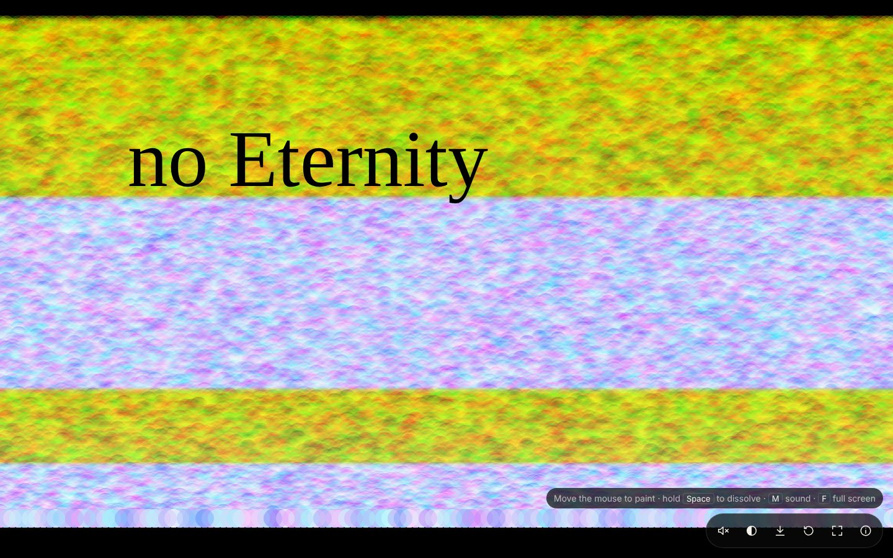

# no Eternity

A generative, iterative and interactive screen-saver artwork, made as a website. By your touch, it changes.

I combine analogue feeling and digital technologies in the creation of my work.
I created composite collages that reflect on relationships between the eternity and its image.
There are no eternity.



## The website

The artwork fills the browser window. It is designed for a desktop or laptop browser:

- **Move the mouse** to paint bands of translucent colour. There's no need to click: the band follows the pointer and keeps building where you stop.
- **Hold the space bar** (or the ◐ button) to dissolve the image. This brings back the blur-and-scratch effect that the sensor-driven version of the original triggered.
- **Leave it alone** and it keeps painting itself, like a screen saver. Press **F** for full screen, which also keeps the display from sleeping.
- **Press M** (or the speaker button) to hear the picture. Sound is off until you ask, and the choice is remembered.
- **Press S** to save the current moment as a PNG.
- Arrow keys move the brush; **I** opens the About panel.

It also works on phones and tablets: drag a finger to paint, and each finger paints its own band.

It is a static site with no server and no tracking, and the code and styles together are under 10 KB gzipped.

### Sound

The sound is generated live with the Web Audio API (no audio files) and follows what is on screen:

| In the picture                                    | In the sound                                                      |
| ------------------------------------------------- | ----------------------------------------------------------------- |
| Height of the brush                               | Pitch, in A minor pentatonic: low at the bottom, high at the top  |
| Blue (horizontal position): warm left, pale right | Tone: dark and soft for warm colours, bright and airy for pastels |
| New paint landing on black                        | The drone swells and painted circles ring out as bells            |
| Painting over paint that is already saturated     | It settles to a quiet hum with the odd bell                       |
| Each bell's circle: position, red, green          | Stereo position; pale circles ring chord tones, warm ones others  |
| How full the picture is                           | How big the room sounds (reverb)                                  |
| Dissolve: blur and black squares                  | Muffled, smeared, slightly detuned sound, with crackle            |
| Every finger                                      | Its own drone                                                     |

Every value is in [`src/sound/mapping.ts`](src/sound/mapping.ts). The engine is [`src/sound/engine.ts`](src/sound/engine.ts).

### Run it locally

You need Node.js 22.12 or newer.

```bash
npm install
npm run dev        # http://localhost:5173
```

```bash
npm test           # unit tests
npm run typecheck
npm run build      # production build in dist/
npm run preview    # serve the build
npm run check      # all of the above, as CI runs it
```

### Deploy to Vercel

1. Push this repository to GitHub.
2. On [vercel.com/new](https://vercel.com/new), import the repository. Vercel detects Vite from `vercel.json`, so keep the defaults (build `npm run build`, output `dist`). No environment variables are needed.
3. Deploy. Every pull request then gets its own preview URL.

To deploy from the command line instead, run `npx vercel` (preview) or `npx vercel --prod` (production).

Link previews (for example in messages and social posts) use the production domain automatically. To use a different domain for them, set `SITE_URL` (for example `https://noeternity.art`) in the Vercel project settings.

`vercel.json` also sets long-term caching for the hashed build files and a strict Content Security Policy. If you later add a third-party script, font or analytics, add its domain to that policy.

### Change the artwork

Every tunable value is in [`src/sketch/config.ts`](src/sketch/config.ts): circle size and spacing, opacity, colour ranges, title, screen-saver speed and the dissolve effect. Each value is annotated with the line of the original sketch it comes from.

| Original (`archive/noEternity/*.pde`)                       | Web (`src/`)                                    |
| ----------------------------------------------------------- | ----------------------------------------------- |
| `one()`: a row of circles at `mouseY`                       | `paintRow()` in `sketch/paint.ts`               |
| `fill(random(10,555), random(10,555), mouseX, 40)`          | `warmChannel()` and `blueAt()`                  |
| `CLASS.display()`: `filter(BLUR)` + rotating black squares  | `blurInPlace()` + `scatter()`                   |
| `text("no Eternity", displayWidth/7, displayHeight/3)`      | `drawTitle()` / `titleLayout()`                 |
| `draw()` at 60 fps, never clearing the background           | the fixed 60 Hz loop in `stage.ts`              |
| Arduino sensors 3 and 4 trigger `CLASS.display()`           | the ◐ button and the space bar                  |
| (no sound)                                                  | `sound/engine.ts`, following `sketch/ink.ts`    |

## History

no Eternity began in 2015 as a Processing sketch: a version driven by Arduino sensors, and an Android app. This website replaces the app. The original sketch is kept in [`archive/`](archive) for reference; the Android project files were removed.

See [docs/REVIEW.md](docs/REVIEW.md) for a review of the original project and what changed in the website.
